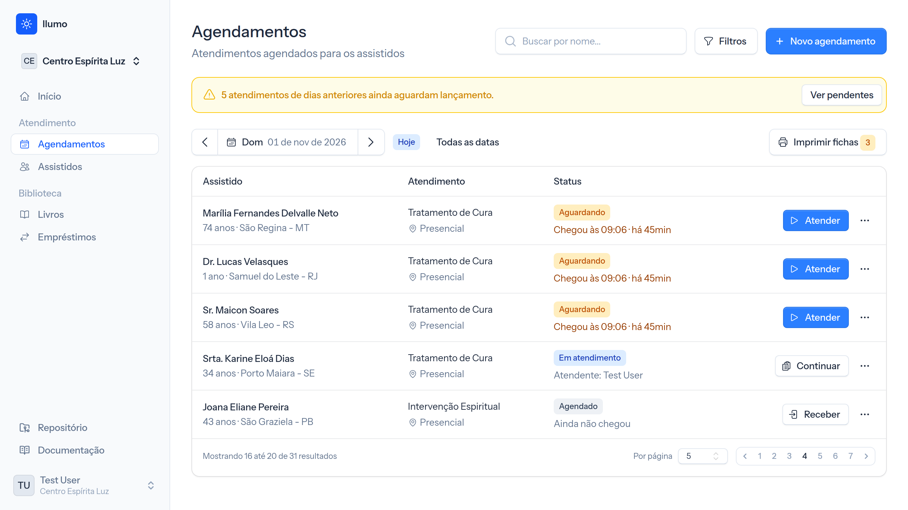
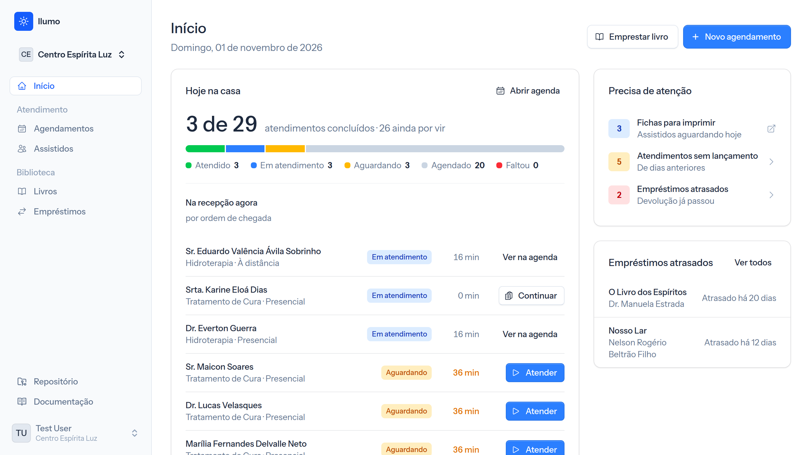
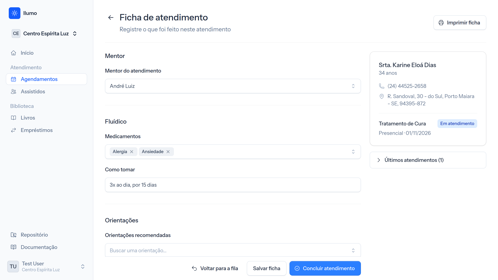
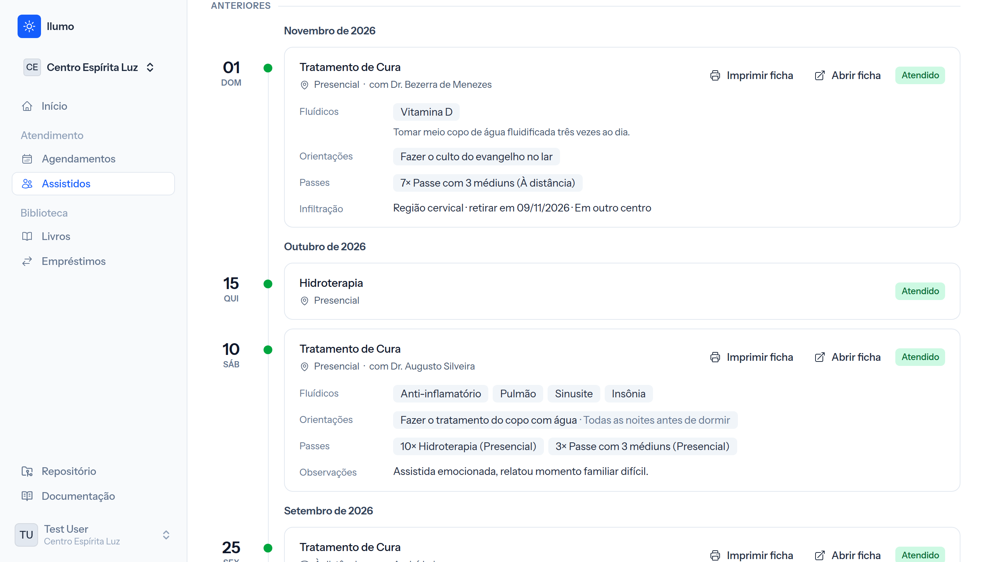
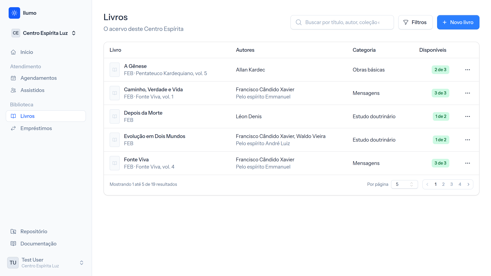

<p align="center">
  
</p>

<p align="center">
  Gestão para centros espíritas — livre, na nuvem ou no seu servidor, e feito com carinho.
</p>

<p align="center">
  <a href="README.en.md">Read this in English</a>
</p>

<p align="center">
  <a href="https://github.com/guilhermepolicarpo/llumo/actions/workflows/tests.yml"></a>
  <a href="LICENSE"></a>
  <a href="https://github.com/guilhermepolicarpo/llumo/releases/latest"></a>
  
  
</p>

## Sobre

O llumo é um sistema de gestão para centros espíritas: cadastro de assistidos, agendamento e registro de atendimentos, controle da biblioteca — o dia a dia da casa em um só lugar.

O nome vem do esperanto *lumo* (luz), língua com ligação histórica com o movimento espírita. É grafado sempre em minúsculas.

Duas premissas guiam o projeto:

- **Os dados da casa pertencem à casa.** Use o llumo cloud sem instalar nada ou instale o llumo no seu próprio servidor e mantenha o controle total das informações dos assistidos.
- **Software livre.** Código aberto sob licença MIT, sem custo de licença e sem dependência de um fornecedor.

> [!NOTE]
> O llumo está em desenvolvimento ativo. Os módulos do dia a dia da casa — assistidos, agendamentos, atendimentos e biblioteca — já funcionam e são cobertos por testes. As versões ainda são `0.x`: podem trazer mudanças maiores entre uma e outra. Veja as [releases](https://github.com/guilhermepolicarpo/llumo/releases) e o [roadmap](#roadmap).

<p align="center">
  
</p>

<p align="center"><em>Agendamentos: a agenda do dia, com a recepção e o atendimento dos assistidos.</em></p>

## Como usar

Há duas formas de usar o llumo, com os mesmos recursos:

- **llumo cloud — [llumo.app.br](https://llumo.app.br).** Crie sua conta, cadastre a casa e comece a usar, sem instalar nada. É hospedado pelo mantenedor do projeto e roda sempre a versão mais recente do código. Ideal para casas que não têm alguém para cuidar de um servidor.
- **No seu servidor (self-hosted).** Instale a partir de uma das [versões publicadas](https://github.com/guilhermepolicarpo/llumo/releases) e siga a [instalação](#instalação) abaixo. Os dados ficam inteiramente na sua infraestrutura.

## Funcionalidades

| Módulo | Descrição | Status |
|---|---|---|
| Casas (multi-tenancy) | Uma instância do llumo hospeda várias casas, cada uma com dados isolados, membros e papéis (Proprietário/Administrador/Membro). Convites por e-mail com expiração. Em **Configurações do centro**, os administradores cuidam dos dados da casa (nome, logotipo, telefone, endereço preenchido pelo CEP), dos membros e dos cadastros. | ✅ Pronto |
| Contas e acesso | Cadastro, login, verificação de e-mail, recuperação de senha, 2FA (TOTP + códigos de recuperação) e passkeys/WebAuthn. | ✅ Pronto |
| Assistidos | Cadastro das pessoas atendidas, com contato e endereço (preenchido pelo CEP), busca e o histórico de atendimentos e empréstimos de cada uma. | ✅ Pronto |
| Agendamentos | Agenda por dia, atendimentos presenciais ou a distância, recepção da chegada e fila de espera, filtros por status, tipo e atendente, e faltas marcadas automaticamente. Tipos de atendimento com dias da semana e limite diário. | ✅ Pronto |
| Atendimentos | Registro do atendimento: mentor, fluídicos (quantidade e posologia), passes, orientações recomendadas, retirada de infiltração, retorno agendado e observações, com rascunho salvo enquanto se preenche. Impressão das fichas de atendimento do dia em PDF. | ✅ Pronto |
| Cadastros | Tipos de atendimento, mentores, fluídicos, orientações e tipos de passe; na biblioteca, autores, editoras, categorias e coleções. | ✅ Pronto |
| Biblioteca | Acervo da casa com busca pelo ISBN nos catálogos públicos (BrasilAPI e Open Library, com capa), exemplares com tombo, empréstimos, renovações e devoluções, controle de atrasos e regras de empréstimo definidas por cada casa. | ✅ Pronto |
| Início | Visão geral da casa ao entrar: agendamentos do dia por situação, atendimentos pendentes de dias anteriores, empréstimos atrasados ou vencendo e os agendamentos dos próximos dias. | ✅ Pronto |
| Financeiro | Controle de receitas e despesas da casa. | 🚧 Planejado |
| Assistência social | Gestão de doações e ações assistenciais aos assistidos. | 🚧 Planejado |

O fluxo central do domínio é: **assistido → agendamento → atendimento**. O assistido é cadastrado, tem um atendimento agendado e, no registro desse atendimento, anotam-se o mentor espiritual que atuou através do médium e os fluídicos prescritos por ele. Os mentores são espíritos protetores e guias — espíritos mais evoluídos que orientam, protegem e auxiliam na evolução moral e espiritual, realizando o tratamento espiritual e de cura durante o atendimento. Os fluídicos ficam vinculados ao atendimento em que foram prescritos, formando o histórico do assistido.

## Telas

<table>
  <tr>
    <td width="50%">
      
      <p align="center"><em>Início: o dia da casa, a recepção e o que precisa de atenção.</em></p>
    </td>
    <td width="50%">
      
      <p align="center"><em>Ficha de atendimento: mentor, fluídicos, orientações e passes.</em></p>
    </td>
  </tr>
  <tr>
    <td width="50%">
      
      <p align="center"><em>Histórico do assistido: tudo o que foi feito em cada atendimento.</em></p>
    </td>
    <td width="50%">
      
      <p align="center"><em>Biblioteca: o acervo da casa e os exemplares disponíveis.</em></p>
    </td>
  </tr>
</table>

## Stack

PHP 8.3+ · Laravel 13 · Livewire 4 (single-file components) · Flux UI 2 · Tailwind CSS 4 · Laravel Fortify · Laravel PDF (DomPDF) · Pest 5 · PHPStan level 7 · Pint · SQLite (padrão) · Vite 8 / vite-plus

## Requisitos

- PHP 8.3 ou superior (a CI roda em 8.5)
- Composer
- Node.js 22 ou superior
- Um banco de dados — SQLite por padrão, sem serviço externo necessário

MySQL e PostgreSQL também funcionam: basta ajustar `DB_CONNECTION` e as credenciais no `.env`.

## Instalação

```bash
git clone https://github.com/guilhermepolicarpo/llumo.git
cd llumo
composer setup
composer dev
```

O `composer setup` cuida de tudo: instala as dependências PHP, cria o `.env` a partir do `.env.example`, gera a chave da aplicação, roda as migrations, instala as dependências JS e compila os assets.

O `composer dev` sobe servidor, filas, logs e Vite juntos (via `php artisan dev`). A aplicação fica disponível em `http://localhost:8000`.

Se você usa [Herd](https://herd.laravel.com), pode dispensar o servidor embutido: aponte o Herd para o diretório do projeto, ajuste o `APP_URL` no `.env` e rode apenas o Vite.

### Dados de demonstração

Para explorar o llumo com dados de exemplo, rode `php artisan db:seed`. Ele cria o usuário `test@example.com` (senha `password`) com uma casa já preenchida: assistidos, agendamentos, atendimentos, cadastros e a biblioteca com livros e empréstimos.

### Em produção

- **Agendador:** configure o cron do Laravel (`* * * * * php artisan schedule:run`). Ele marca como falta os agendamentos de dias anteriores que não foram atendidos e apaga os convites expirados.
- **Filas:** mantenha um worker rodando (`php artisan queue:work`).
- **Serviços externos:** a busca de endereço pelo CEP e de livros pelo ISBN usa as APIs públicas e gratuitas da [BrasilAPI](https://brasilapi.com.br) e da [Open Library](https://openlibrary.org). Os endereços podem ser trocados por `BRASIL_API_URL` e `OPEN_LIBRARY_URL` no `.env`.
- **Cache de views:** rode `php artisan view:cache` (ou `view:clear`) a cada deploy, para que as traduções dos componentes do Flux entrem nas views compiladas.

## Desenvolvimento

| Comando | O que faz |
|---|---|
| `composer dev` | Servidor, filas, logs e Vite |
| `composer test` | Suíte completa: Pint (check), PHPStan e Pest |
| `composer lint` | Formata o código com Pint |
| `composer types:check` | Análise estática (PHPStan level 7) |
| `php artisan test --compact` | Só os testes |

O `composer test` é exatamente o que a CI executa em cada push e pull request. Rode-o antes de abrir um PR.

## Roadmap

Já prontos: assistidos, agendamentos, atendimentos, mentores e fluídicos, biblioteca, a tela de início e a tradução da interface para pt-BR.

A seguir:

1. **Financeiro** — controle de receitas e despesas da casa
2. **Assistência social** — gestão de doações e ações assistenciais aos assistidos

Além dos módulos, no radar:

- **Imagem Docker e guia de deploy** — para tornar o self-host o mais simples possível
- **Lembretes** — avisos de agendamento, retorno e devolução de livros, para reduzir faltas
  - E-mail como canal padrão e link "Enviar no WhatsApp" (`wa.me`) com a mensagem pronta, ambos sem custo
  - Bot do Telegram como opção automática gratuita
  - WhatsApp oficial (Cloud API da Meta) opcional, com botões para o assistido confirmar ou cancelar e o agendamento atualizado automaticamente
  - Provedor configurável: um número único para todas as casas da instância ou o número próprio de cada casa
  - Nome da casa em toda mensagem, limite de envio por casa, opção de não receber mais e consentimento do assistido registrado (LGPD)
  - Registro dos envios por casa, para acompanhar o uso e o custo
- **Autoagendamento** — página pública da casa onde o assistido escolhe o tipo de atendimento e o dia, respeitando os limites diários
- **Ficha digital do assistido** — posologia dos fluídicos e orientações acessíveis no celular por QR code
- **Check-in por QR code** — registro da chegada na recepção sem digitação
- **Indicadores** — atendimentos por mês, taxa de faltas, tipos mais procurados e livros mais emprestados na tela de início
- **Escala de voluntários** — quem atende em cada dia, com troca de plantão entre médiuns e passistas
- **Cursos e grupos de estudo** — turmas (ESDE, evangelização, mocidade) com controle de presença
- **PWA e modo offline** — preenchimento do atendimento mesmo com internet instável, sincronizando depois
- **Conformidade com a LGPD** — termo de consentimento, exportação e anonimização dos dados do assistido e registro de acessos
- **Rede entre casas** — integração opcional entre instâncias para compartilhar acervo e encaminhar assistidos
- **Inteligência artificial** — recursos opcionais, ativados por casa, que apoiam a rotina sem nunca sugerir tratamento espiritual (fluídicos, passes e orientações cabem ao mentor e aos médiuns)
  - Digitalização de fichas de papel: fotos das fichas antigas viram assistidos e atendimentos no llumo
  - Cadastro de livros por foto da capa ou da página de créditos, inclusive livros antigos sem ISBN
  - Ditado das observações durante o atendimento
  - Perguntas em linguagem natural sobre os números da casa ("quantos atendimentos a distância em março?")
  - Resumo factual do histórico do assistido antes do atendimento
  - Previsão de faltas, com lembrete reforçado para quem tende a faltar
  - Livros do acervo relacionados às orientações registradas no atendimento
  - Roteiros e perguntas de discussão para os grupos de estudo
  - Agendamento por conversa no WhatsApp ("quero marcar para quinta")
  - Provedor configurável: API externa ou modelo local (Ollama) no self-host, com registro de uso por casa e atenção aos dados sensíveis (LGPD, art. 11)

## Contribuindo

Contribuições são muito bem-vindas. Veja o [CONTRIBUTING.md](CONTRIBUTING.md) para o setup local, os padrões de código e o fluxo de pull request. Para começar, procure as issues marcadas com [`good first issue`](https://github.com/guilhermepolicarpo/llumo/issues?q=is%3Aissue%20is%3Aopen%20label%3A%22good%20first%20issue%22).

Ao participar do projeto, você concorda em seguir o nosso [Código de Conduta](CODE_OF_CONDUCT.md).

## Segurança

Encontrou uma vulnerabilidade? Não abra uma issue pública. Reporte pelo [GitHub Security Advisories](https://github.com/guilhermepolicarpo/llumo/security/advisories/new) do repositório.

## Comunidade

- [Issues](https://github.com/guilhermepolicarpo/llumo/issues) — bugs e sugestões de funcionalidades
- [Discussions](https://github.com/guilhermepolicarpo/llumo/discussions) — dúvidas, ideias e conversa em geral

## Licença

O llumo é software livre sob a licença [MIT](LICENSE).
